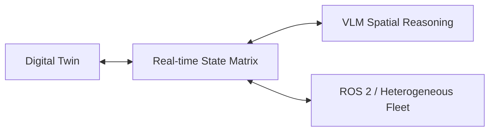

# Project Moonbase

### Spatial intelligence for embodied fleets.

One command surface for humanoids, quadrupeds and mobile robots: a spatial twin, articulated state and fleet telemetry in the browser.

**Interactive demo:** deployment pending. Run locally below, or deploy this repository with the included GitHub Pages workflow / Vercel configuration.

**Embodied Digital Twins:** Includes the complete 19-DOF Unitree H1 humanoid mesh (`h1.glb`), Nova Carter AMR, and Unitree Go2 quadruped models matching the production Moonbase operations platform.


The diagram presents the broader system concept. The public implementation here is the client showcase only. Model/vendor choices shown in the architecture are not benchmark or readiness claims.



## Try the spatial console

```sh
npm ci
npm run dev -- --mode production
```

Open the address Vite prints. Select agents, orbit the twin, inspect synthetic joint loads, toggle occupancy, and pause or resume the gait. No ROS installation, GPU workstation or API account is required.

All three embodiments accept waypoint sequences. In Agentic mode, the local demo parser also understands saved locations, `move to 1, 2`, and `turn left 90 then move forward 1 m`. It resolves simple movement phrases without an AI model. STOP holds a running sequence; Resume continues it. Completed missions hold their final pose.

The Fleet drawer has a delete button for each bot. Deleting the selected bot focuses a remaining unit; deleting a mission owner cancels its mission. Bots can be removed and redeployed, including after the fleet is empty. Spawn locations are checked against robot bodies, obstacle boxes and scene bounds, with a message explaining invalid placement.

Navigation uses local A* pathfinding around obstacle boxes and other bots, then smooths the route using swept body-clearance checks. Try `Go to terminal, then go home`. Routes are recomputed at dispatch and detour around newly appearing blockers during movement. If the destination is occupied or no safe path exists, the bot holds with an explanation. Resume searches again. Conservative body radii include 0.10 m clearance.

The scenario is 20 × 16 m, with ROS XY bounds `[-8,-8,12,8]`. Spawning, picking, routing and synthetic floor occupancy share these bounds.

One world unit is one metre. The existing models are calibrated in their reference standing pose: H1 is 1.805 m tall with uniform scaling; Go2 is 0.70 × 0.31 × 0.40 m (length × width × height); Carter P1 is 0.722 × 0.500 × 0.556 m. Carter and Go2 retain their simplified production presentation meshes; matching overall dimensions does not make these CAD or collision assets. Pose changes alter the visible envelope. Sources: [Unitree H1](https://www.unitree.com/h1/), [Unitree Go2](https://www.unitree.com/go2/), [Segway Carter P1 manual](https://robotics.segway.com/wp-content/uploads/2023/11/Nova-Carter-Product-Manual-v1.0.pdf).

Waypoint drafts are saved per bot. Switch units to restore their drafts; reached waypoints disappear as the route runs. Click the floor in either camera mode to add targets. Dragging the camera does not add waypoints.

Locations has one marker per saved place. Enter a name, choose Drop a pin, click the floor, then Save pin. The trash button deletes a location. Robots retain their standing offsets and have a per-frame floor recovery guard.

Voxels toggles the synthetic floor/obstacle point cloud. The decorative flowing sensor fields surround every fleet unit independently of the Perception drawer; Sensor motion in Settings pauses that animation. The Perception tool highlights only while its drawer is open.

```sh
npm test
npm run build
npm run preview
```

Use Node.js 24. The production flag is `VITE_DEMO_MODE=true` in `.env.production`. Disabling it makes the preview inactive. There is no live transport to enable. npm dependency installation requires registry access; after installation the build and application use local resources only.

## What this demonstrates

- Exact production Spatial HUD UI: full-bleed 3D viewport, tool palette (`3D | 2D` camera, perception, waypoints, voxels, fleet), equalizer telemetry bars, and mission control.
- Heterogeneous embodiment switching between Unitree H1 Humanoid, Nova Carter AMR, and Unitree Go2 Quadruped.
- A 19-joint articulation contract with real-time skeletal kinematics streaming.
- Dynamic ground ripples, floor dot matrix, and static `elbow-v1` obstacle voxel scene.
- A client-side in-browser showcase with zero network requirements or backend services.

**Broader project stack:** ROS 2, Fast DDS, NVIDIA Isaac Sim, PPO locomotion and VLM spatial reasoning. Those systems are not included or executed in this repository. Synthetic demo motion must not be used as evidence of physical robot performance or obstacle avoidance.

## Specifications

- [Spatial orchestration UI specification](docs/SPATIAL-ORCHESTRATION-UI-SPEC.md)
- [MBVX v1 and Foxglove joint schema](docs/TELEMETRY-PROTOCOLS.md)
- [Publication boundary and release checklist](docs/PUBLICATION.md)
- [Capture plan for approved 60 FPS media](public/media/README.md)

## Deploy

For GitHub Pages, choose **GitHub Actions** as the Pages source in repository settings, then run **Deploy showcase** manually. The workflow tests, builds, audits and publishes `dist/`. Relative asset paths support this repository's Pages subdirectory. The deployment job reports the final live URL; replace the pending demo notice only after it succeeds. See the [Vite deployment guide](https://vite.dev/guide/static-deploy.html) and [GitHub Pages workflow documentation](https://docs.github.com/en/pages/getting-started-with-github-pages/using-custom-workflows-with-github-pages).

For Vercel, import this repository as a Vite project. The included config uses `npm run build` and output directory `dist`. No private environment variables are needed.

## Contact

Project Moonbase is in active development. For commercial inquiries, partnerships, or investment:
- **Email:** [rileyc.marek@gmail.com](mailto:rileyc.marek@gmail.com)
- **GitHub:** [@RileyMarek](https://github.com/RileyMarek)

Public visibility does not itself grant a software license. A project license has not yet been selected; dependencies retain their respective licenses.
